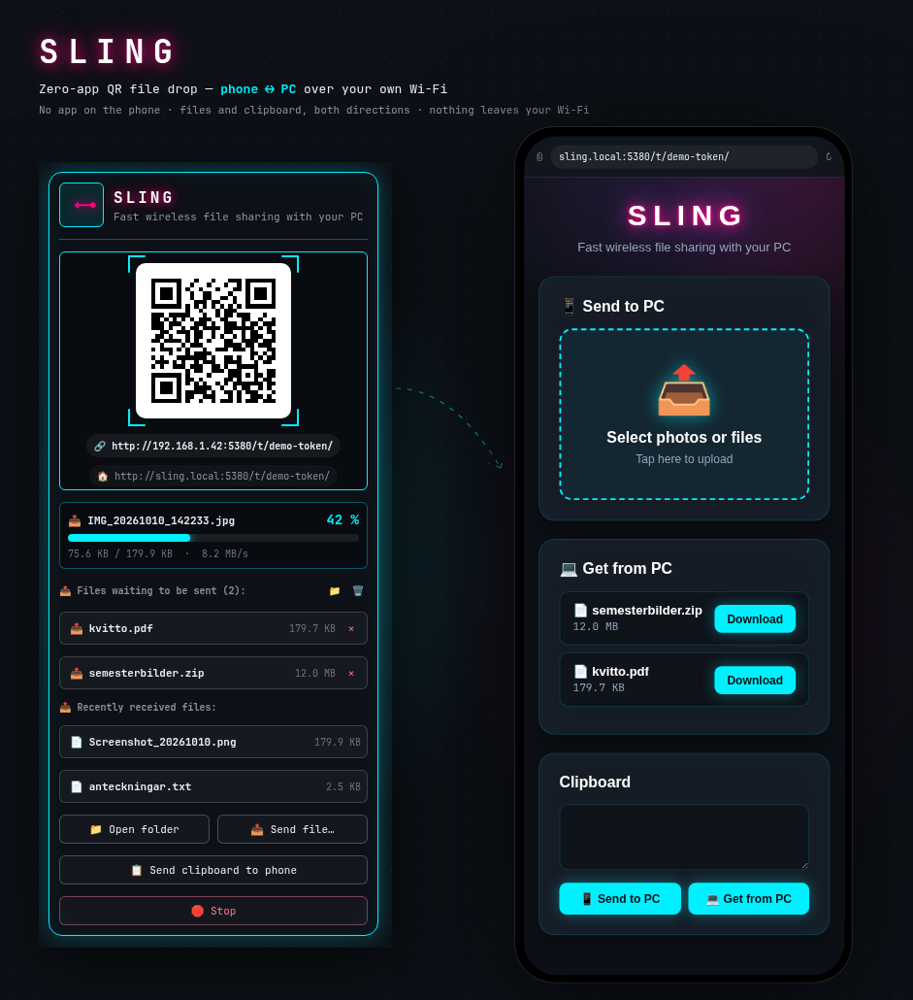

# Sling 🚀📱💻
**Zero-App QR File Sharing Between Phone & PC for [Omarchy](https://omarchy.org) / Quickshell**

Sling files between your smartphone (iPhone or Android) and your Linux PC with **zero apps to install on your mobile device**. Scan the QR code in the bar and the transfer portal opens in your phone's browser.


Current version: `1.3.0`.

---

## ✨ Features

* **📷 Zero Mobile Installation:** Point your regular phone camera at the QR code in the top bar and the transfer portal opens on your local Wi-Fi.
* **📱 Send from Phone to PC:** Tap to pick photos, videos or documents — files land in `~/Downloads/Sling/Received/`.
* **💻 Send from PC to Phone:** Put files in `~/Downloads/Sling/Send/`, or press **📤 Send file…** in the panel (file picker), and download them on the phone with one tap. Queued files are symlinked, not copied, so a 2 GB video costs no extra disk.
* **📊 Live Progress:** A transfer dock in the panel shows direction, file name, a large percentage, the filled bar and MB/s while a file moves — and the bar label itself switches to the percentage, so a long transfer is visible without opening anything. The phone's page has its own progress bar during uploads.
* **🔔 Native Desktop Notifications:** A desktop notification with the file count arrives as soon as transfers complete.
* **🔐 Token-gated:** Every request must carry a random token in the URL (`/t/<token>/`), created at start and carried by the QR code. Without it the server answers 403 and reveals nothing.
* **💤 Disarms itself:** The server exits after 15 minutes without traffic (`SLING_IDLE_TIMEOUT`), so leaving it started does not leave a permanent door open.
* **🏠 A name to remember:** `http://sling.local:5380` is published over mDNS (Avahi) and shown in the panel, so the address survives the router handing out a new IP. The QR code still carries the IP, because Android does not resolve `.local` reliably.
* **🌐 Automatic System & Browser Language (i18n):** English, Svenska, Nederlands, 日本語, Deutsch, Français, Español, 中文 — on both the PC and the phone.
* **🔒 100% Local & Private:** Direct peer-to-peer over your local Wi-Fi network. No cloud, no external servers, no tracking.

---

## 📦 Requirements

| Dependency | Needed for | Install (Arch/Omarchy) |
|---|---|---|
| `qrencode` | the QR code (**required**) | `sudo pacman -S qrencode` |
| `avahi` | the `sling.local` name (optional) | `sudo pacman -S avahi && sudo systemctl enable --now avahi-daemon` |
| `zenity` | the **Send file…** picker (optional) | `sudo pacman -S zenity` |
| `libnotify` | desktop notifications (optional) | usually already installed |
| `wl-clipboard` | the copy-link button (optional) | usually already installed |

Only `qrencode` is required; the rest degrade gracefully — the panel reports what is missing (`omarchy-sling status` → `"qr_ok": false`) instead of showing a blank square. The daemon itself is Python 3 standard library only.

Verify a build at any time — `selftest` starts its own server on a spare port in a scratch directory and runs **136 checks**: files of four sizes uploaded and compared byte for byte, the token gate (403), the size cap (413), duplicate names, twelve concurrent uploads of the *same* name getting twelve distinct files (the name is reserved and the file created in one syscall — checking first and opening afterwards let two uploads write over each other), an upload that is cut off mid-body leaving no half file behind, a file that disappears while the panel polls `/status` being skipped instead of killing the request, queue deduplication and removal (the source file always survives), two `send`s racing for the same name never writing into each other's source file — the loser takes the next free name instead of letting `copy2` write through the first one's link, and the idle timer counting an in-progress transfer as activity, so it cannot cut a slow transfer off mid-flight, the connection cap and read deadline (threads and file descriptors stay bounded when a silent peer opens more connections than the cap), the clipboard in both directions (the shared text never reaches argv or a notification, and the slot, the token file, the pid file, the state directory and the QR image are created with 0600/0700 from the start, never chmodded afterwards), that a clipboard source which never finishes streaming, never closes, forks a child that keeps the pipe open, or never returns at all is cut off by the byte cap and the deadline without leaving a process behind or holding a server thread, that the same holds for the notification on both request paths and for the clipboard copy the panel's **Copy** button triggers (a `notify-send` or `wl-copy` that never finishes neither holds the upload nor leaves a process behind), that received files are created 0600 rather than through the umask, that disarming removes the token, pid, URL and QR files, that two simultaneous `start`s (a double click in the panel) leave a URL and QR whose token the *running* server accepts — and its state files alone, that `stop` picks its targets out of `/proc` by exact shape — the script path this file actually runs at plus the `server` argument — and refuses a process whose command line merely mentions the script or the publisher's name, so `rg server omarchy-sling` or an editor opened on those two files is not touched, and that `stop`'s fallback waits for a reply with *our* token before signalling anything, since a listener on the port is not evidence that the listener is ours, that the state directory stays out of `/tmp` when `XDG_RUNTIME_DIR` is unset and that a state directory planted as a symlink is refused instead of written into, that a pid file naming someone else's process is refused rather than signalled, that a filename carrying a NUL byte or `..` is skipped while the rest of the same upload still arrives, that a running transfer is visible through both the server's `/status` and the CLI the panel polls, as a **list** — the dock draws one row per live transfer (`actives`, newest first, up to three rows) with `active` as the first of them, so the bar label and the phone page read the same first record and the percentage is computed in one place — and that every key the dock reads out of a transfer (`dir`, `name`, `pct`, `human_done`, `human_total`, `speed`) is a key the server actually sends, because a renamed key shows as `undefined` in the bar with no QML warning and nothing in the journal — and that a **drop on the bar button is bounded**, since the dragged list comes from a foreign drag source that decides the count, the length and the encoding of the URLs: at most `dropMaxFiles` (100) paths, `dropMaxPath` (4096) characters each and `dropMaxBytes` (512 kB) in total are queued, a URL whose percent-encoding is broken is skipped instead of killing the whole drop (measured in the real widget: `decodeURIComponent` threw `URIError` and the drop queued nothing at all, silently), and what was skipped is named in the tooltip rather than disappearing (measured: 300 dropped URLs queue 100 and report 200, 30 000 likewise in 1 ms — before the limit the same list went into one process argument list, and an argument list past the `exec` limit makes `execDetached` answer `undefined`, which nothing looked at) — and that two transfers at once (a browser posting two files, or a download while an upload runs) no longer share one record: each transfer keeps its own, the panel shows the newest that is still live, and the one that is not shown no longer has its name, total or percentage mixed into the other (with one global record the later transfer overwrote the earlier and the first was invisible — measured), while a progress figure is never allowed past 100 % even when a lying `Content-Length` says otherwise, and that the mDNS address is only reported when something actually publishes it — an address the panel presents as "the one to remember" must not be one that nothing answers — with a publisher left behind by a hard-killed server being taken back at the next start instead of holding the name — and that the source text itself cannot reintroduce a class that has already cost a round (no name compared against another process's `argv`, no `os.open` without a mode at creation, no reply body carrying an exception's own text — it can hold an absolute local path — the scanners proven to bite on a crafted snippet of the old shape), and that a request which declares a body and never has it read — a wrong content type, an unknown path, a bad token, or a body on a `GET` — closes the connection instead of leaving those bytes for the next request to be parsed out of (measured before: one `POST /upload` with a JSON content type and a valid `GET` hidden in the body produced **two** answers on a single request, `400` then `200`; a `POST` to an unknown path produced `404` then `200`), and that the cap counts files and not only bytes — one request may carry at most `SLING_MAX_PARTS` parts that become files and is then refused as a whole, with everything it had already written removed, while a request exactly on the cap still goes through (measured: 366 KB of one-byte parts became 3000 files and 12.3 MB on disk, 32.8 × the body, and the same shape at the 2 GiB cap would have been ~16 M inodes) — and that a save which fails answers `500` with a generic message while the reason stays in the log (measured before: `[Errno 13] Permission denied: /home/…/Received/b.bin` went to the phone) — and that no reply header carries the interpreter's version (the `Server:` line names the plugin and stops there), and that every reply carries `Referrer-Policy: no-referrer` and `X-Content-Type-Options: nosniff` — the token lives in the URL, so the header that matters is the one that keeps it from travelling anywhere else, and it is checked on the page, on `/status` and on a download (measured before: those three replies carried only `Server` and `Cache-Control`), that **every** call to a known resource sink in the file — subprocess, read, wait, opening a connection — carries a bound or is named with a reason in `STRYP_UNDANTAG` (the inventory is run as part of the suite, and stands alone as `omarchy-sling audit`: 5 subprocess calls, 19 reads, 1 wait and 3 network calls are accounted for — the counts describe the plugin, not its test half, which is excluded from the numbers the same way it is excluded from the verdict (so they no longer move every time a test gains a call, and a number in this file that nothing checks is a note rather than a claim: the suite compares this sentence against its own count and names both sides when they part), and adding an unbounded one *anywhere* in the file turns the suite red with its function and line — proven both on a copy of the file carrying a brand-new `fh.read()` and `proc.wait()`, and on made-up source the suite feeds to the same rule: a bare read, a literal above the cap, a loop over an opened file object and a new connection must each come back red, or the rule is only a habit). Every exception is pinned to a function, a family and the exact number of sinks it was written for, so an extra read inside a function that is already excused comes back red instead of staying invisible — a reason that covers a whole function attests to itself. The read family is what a reader actually writes (`os.read`, `sendfile`, `copyfileobj`, `recv_into` and `for line in fh:` — a read with no call at all — are in), every connection needs its pinned reason, and the suite's own code is excluded structurally rather than by excuse, since it runs only when you ask for it and sits on no request path), and that the server bounds a request, not just a read — a peer drip-feeding the request line or the body is dropped at `SLING_REQUEST_DEADLINE` or the body's own deadline instead of holding one of the connection slots forever with no token (measured 2.4 s against a 2 s deadline, with no half file left behind, and with an idle keep-alive socket deliberately left uncut), and that the reply is bounded the same way — writes are the same class as reads, and `sendall` hides them: a peer sipping a 96 MB download at ~30 KB/s used to hold one of the slots inside a single `sendall` for over 20 s while the deadline was 2 s, since every individual `send` returned in time; the transfer is now abandoned at the deadline (measured: gone from `/status` after 8 s with 256 KB of 100 MB sent) and the socket is closed instead of left half-written — and that the panel's *running* means our own server answered with our token rather than the port simply being open (with a foreign listener on the port: `running: false`, where the old code reported `running: true` with our URL and a scannable QR), and that **every** entry point the panel or the CLI can reach — `status`, `clip`, `remove`, `clear` — returns within the deadline and inside the memory cap against a foreign listener that stays silent, drips one byte at a time, or streams forever (each in a child with a 300 MB limit, so an unbounded read shows up as memory rather than as a starved machine), and that the poll the panel actually makes — the CLI reading the server's own `/status` — is bounded across the **whole** transaction, not per read: a listener that never finishes the status line, one that never finishes a header, one that drips a chunk-size line, one that drips the trailer block and one that drips the body all end at the deadline (measured 4.0 s) rather than holding the poll open, with the four framing phases proven to fail on the previous implementation — which kept such a poll blocked past 20 s — before they were believed:

```bash
omarchy-sling selftest
```

`selftest` proves *behaviour*, and its first checks are an *inventory*: the file is parsed and every
call to a known resource sink — subprocess, read, wait, opening a connection (`urlopen`, `connect`,
`create_connection`) — must carry a bound or stand in `STRYP_UNDANTAG` with a reason. `selftest` therefore fails on a class, not on the instance a review
happened to name: an unbounded read added anywhere in the file, by anyone, is red with its line
number before a single request is sent. The inventory also stands alone:

```bash
omarchy-sling audit
```

`abuse` runs the same suite and then works the whole untrusted
surface: every entry point — the token gate, the HTTP framing, the multipart body, file names,
downloads, the clipboard in both directions, the phone page, the sockets, the state files and the
process table — against every class a security review has ever filed against this plugin (bounds,
identity, permissions, races, markup, `argv`/stdin, path, silent failure, lifecycle). Each cell is
either tried or declared *not applicable* with its reason, and the run prints that matrix at the end,
so an uncovered cell has to be stated rather than assumed:

```
  Otillförlitlig yta: 49 celler prövade i den här körningen
    token/HTTP         prov: bounds, identitet, sökväg, tyst fel
                       n/a:  markup, argv, rättigheter, race, livscykel: ingen data ur en förfrågan når en fil, en process eller en yta
    /upload            prov: bounds, sökväg, rättigheter, tyst fel
                       n/a:  markup, argv, identitet, race, livscykel: kroppen blir filer i en privat katalog, aldrig uppmärkning eller ett argument
    ...
```

```bash
omarchy-sling abuse        # samma svit, plus 65 skräpade celler — 201 kontroller
```

Everything runs against the suite's own server on a spare port in a scratch directory: nothing on
your clipboard, nothing in `~/Downloads/Sling`, nothing on screen, and no traffic outside loopback.

---

## 🛠️ Installation

```bash
omarchy plugin add https://github.com/alexwest1981/sling.git --enable
```

The widget runs the CLI that ships beside it (`bin/omarchy-sling` inside the plugin folder), so
nothing needs to be on your `PATH`. For terminal use, symlink it:

```bash
ln -s ~/.config/omarchy/plugins/io.github.alexwest1981.sling/bin/omarchy-sling ~/.local/bin/omarchy-sling
```

**The one manual step** — and the reason the marketplace lists Sling as *manual setup* — is the
firewall line below: a stock Omarchy enables `ufw` with `deny incoming`, and Sling needs the port for
the phone to reach it. One command, once.

### Allow Sling in your Firewall (Port 5380)

Linux firewalls block incoming connections from the local network by default. Allow incoming traffic on port `5380/tcp`:

* **If you use UFW (Omarchy default):**
  ```bash
  sudo ufw allow 5380/tcp
  ```

* **If you use firewalld:**
  ```bash
  sudo firewall-cmd --add-port=5380/tcp --permanent
  sudo firewall-cmd --reload
  ```

* **If you use nftables:**
  ```bash
  sudo nft add rule inet filter input tcp dport 5380 accept
  ```

### Restart Omarchy Shell

```bash
omarchy-restart-shell
```

---

## 🕹️ Usage

**From the panel:** click the bar icon — the server starts and the QR code appears inside the neon reticle. **Drag a file onto the bar icon** and it is queued for the phone immediately (no picker window). Below it: the `sling.local` address, the transfer dock (which reads *Ready — waiting for a file* when nothing is moving), the send queue and the last received files. The queue lists the first five files waiting for the phone with a `✕` per file, plus **📁 Open Send folder** and **🗑 Clear all** — a `+ N more…` line opens the folder. Buttons: **📁 Open folder**, **📤 Send file…**, **📋 Send clipboard to phone** (the phone reads it in its *Clipboard* card, and can paste text back the other way), **▶ Start / 🛑 Stop**.

The panel and the phone page, both drawn from the code itself — `tools/preview/` renders them:



**From the terminal:**

```bash
omarchy-sling start                  # start the server, print the token URL
omarchy-sling status                 # JSON: running, url, mdns_url, qr_ok, active, queues
omarchy-sling send ~/Pictures/a.jpg  # queue files for the phone (symlinked, never twice)
omarchy-sling send-pick              # queue files via a file picker
omarchy-sling remove a.jpg           # unlink one file from the queue (the original is untouched)
omarchy-sling clear                  # empty the whole queue
omarchy-sling clip                   # share the PC clipboard with the phone (panel button too)
omarchy-sling copy [mdns]            # put the token URL in the clipboard (wm-agnostic stdin, never argv)
omarchy-sling open [send|received]   # open the Received (default) or Send folder
omarchy-sling stop                   # stop now (SIGTERM, then SIGKILL)
omarchy-sling selftest               # the 136 checks above
```

`status` reports the running transfers under `actives` (newest first; direction, file name, bytes, total, percentage and speed each), read from the server itself — the same values the panel draws — with `active` as the first of them, which is what the bar label and the phone page use.

Environment overrides: `SLING_PORT` (5380), `SLING_IDLE_TIMEOUT` (900 s), `SLING_MAX_UPLOAD` (2 GiB per request), `SLING_MAX_PARTS` (1000 files per request), `SLING_MIN_FREE` (256 MB free space floor), `SLING_MAX_PER_IP` (16 connections from one address), `SLING_MIN_FREE_FILES` (1000 free inodes, only where the filesystem has a fixed inode table), `SLING_MAX_CONNECTIONS` (32), `SLING_SOCKET_TIMEOUT` (30 s), `SLING_REQUEST_DEADLINE` (10 s), `SLING_BODY_MIN` (30 s), `SLING_BODY_RATE` (64 KB/s), `SLING_RESPONSE_MIN` (30 s), `SLING_RESPONSE_RATE` (64 KB/s), `SLING_STATUS_MAX` (1 MB), `SLING_STATUS_DEADLINE` (4 s), `SLING_CLIP_MAX` (64 KB), `SLING_CLIP_TIMEOUT` (5 s), `SLING_BASE_DIR` (`~/Downloads/Sling`), `SLING_MDNS_NAME` (`sling`).

---

## 🔐 Security model

The server has to listen on `0.0.0.0:5380` — the phone must reach it — so the protection is not the bind address but three gates:

1. **A token in the path.** Everything lives under `/t/<token>/`; a request without it gets 403 and learns nothing. The token is regenerated on every start and only appears in the panel, the QR code and `status`.
2. **Auto-disarm.** No traffic for `SLING_IDLE_TIMEOUT` (15 min by default) and the process exits, deleting its token.
3. **A hard size cap, per request — in bytes and in files.** `SLING_MAX_UPLOAD` is checked before the body is read, so a single request cannot exceed it and a client that keeps sending past the limit is cut off before anything is written. Ten uploads of the limit still add up to ten times the limit — the cap is per request, not a quota on the folder. The size cap counts *bytes*, so a second cap counts *files*: `SLING_MAX_PARTS` (1000) is the number of parts in one request that may become files, because each part costs an inode and a block of its own. Measured: a 366 KB body carrying 3000 one-byte parts produced 3000 files and 12.3 MB on disk — 32.8 × the body, since each file costs 4 KB of blocks — and the reply carries every name; the same shape at the 2 GiB cap would have been ~16 M files, which is enough to exhaust the inodes of an ordinary home partition. A request over that count is refused as a whole (`413`) and the files it had already written are removed, rather than keeping the first N and letting a refused request look like a successful one. An upload that dies mid-body leaves no file behind: the part being written is removed unless its closing boundary arrived. A request that fails while saving answers `500` with a generic message — the reason goes to the log, because an exception's own text can carry an absolute local path (measured: `[Errno 13] Permission denied: /home/…/Received/b.bin` was sent to the phone). And because a per-request cap is not a quota, the cap is paired with a floor on the partition itself: `SLING_MIN_FREE` (256 MB) refuses a request whose body would leave less than that free, answering `507` with nothing written (`shutil.disk_usage` on the destination, checked before the first read, so a lying `Content-Length` costs nothing). A quota would have needed bookkeeping, an owner and a deletion policy; free space is already known, is checked against the filesystem that would actually fill, and protects everything else on that partition too. The floor counts inodes as well as bytes, because bytes alone are blind to one shape: measured, 1000 empty parts created 1000 files in `Received/` and moved the free space by **exactly 0** (an empty file costs an inode and no block), so the byte floor said nothing while 1000 inodes were spent. `SLING_MIN_FREE_FILES` (1000, plus room for one request's `SLING_MAX_PARTS`) refuses that shape — but only where the filesystem reports a fixed inode table: this machine's btrfs reports `f_files = 0` and has no such limit, where a check that pretended otherwise would be wrong, so the inode rule is inert there by design. Measured with the disk full (ENOSPC injected): a clean `500` in 0.00 s with a generic body, the completed part left in place, the server alive, and the real reason — `[Errno 28] No space left on device` — in the log.
4. **Bounded connections and reads.** The token is checked only once a request has been read, so the socket has to be bounded before that: at most `SLING_MAX_CONNECTIONS` (32) connections are accepted at a time — the rest get `503` and are closed instead of being queued — and at most `SLING_MAX_PER_IP` (16) of them from one address, because a global cap alone still lets one peer take the whole table and leave the phone with `503` while none of its connections has done anything. Sixteen is a choice, not a law: a browser opens at most six connections per host, a download manager wants more, and the suite's twelve simultaneous uploads still pass at exactly this number; several devices behind one NAT share their sixteen, which on a LAN normally means one address per device — and every connection has a `SLING_SOCKET_TIMEOUT` (30 s) deadline per read and write, so a peer that connects and then says nothing releases its thread and file descriptor. Because a deadline per read is not a deadline for the conversation, a request also carries an **absolute** one: `SLING_REQUEST_DEADLINE` (10 s) from the first byte of the request line to the end of the headers, and `max(SLING_BODY_MIN, size / SLING_BODY_RATE)` (30 s floor, 64 KB/s) for the body once its length is known and the sender has the token. A reply carries its own absolute deadline for the same reason, with the same shape — `max(SLING_RESPONSE_MIN, size / SLING_RESPONSE_RATE)` (30 s floor, 64 KB/s) — and it has to be a deadline and not a per-write timeout, because `sendall` (which is what `wfile.write` is) does not return until the whole block is queued: a peer reading a byte at a time keeps every single `send` inside its own timeout, so the per-write bound never fires and a deadline measured between blocks is never reached. Measured: with the deadline at 2 s the server sat in the same `sendall` for over 20 s while a peer sipped a 96 MB file at ~30 KB/s, holding one of the 32 places the whole time. The reply is now sent one `send` at a time with the deadline measured before each, so an abandoned transfer leaves `/status` and the socket is closed instead of being left half-written (check: the transfer is gone, less than a tenth of the file went out, and the client gets EOF once the kernel's buffer has drained). A peer drip-feeding a byte just inside the per-read timeout used to hold one of the 32 places for as long as it liked, with no token at all; the deadline belongs to the request and not to the connection, so an idle keep-alive socket waiting for your next tap in the browser is not cut (that, too, is a check). A request that declares a body the server never reads — a wrong content type, an unknown path, a bad token, or a body on a `GET` — must not leave those bytes in the socket either: on a keep-alive connection they are parsed as the next request. Measured before: one `POST /upload` with a JSON content type and a valid `GET` hidden in the body produced **two** answers on a single request (`400` then `200`), and a `POST` to an unknown path produced `404` then `200`. Every such path now closes the connection, while the two size-cap paths drain what they can and close themselves; the check asks each of the four paths for exactly one answer and a closed connection. Measured: 200 silent connections take the server to 34 threads / 36 fds (2/4 at rest) and back down again; before the cap the same 200 held 202 threads / 204 fds. A file that disappears mid-request — you clearing the folder while the panel polls — leaves the request *answered* (the row is skipped, a download gets 404) rather than a connection that dies with no reply: measured, 3092 of 5634 `/status` polls lost their answer before this. No subprocess on a request path (qrencode, `wl-paste`, `wl-copy`, `notify-send`, `xdg-open`) runs without both a byte cap and a deadline, and neither does the CLI's own reading of the server's replies: `server_status` reads through `läs_takad`, which caps the body at `SLING_STATUS_MAX` (1 MB) **and** the total time at `SLING_STATUS_DEADLINE` (4 s) — measured against a foreign listener on the port, an endless response was buffered to 277 MB before memory ran out, and a response dripping one byte at a time held the command with no return in 25 s, since urllib's `timeout` applies per read and not to the whole reply. Both numbers are re-measured by the suite, in a child with a 300 MB limit, for the reader itself and for every entry point (`status`, `clip`, `remove`, `clear`) against a peer that stays silent, drips, or streams — and the same suite covers each step of the reply the poll can be made to wait on: a peer that never finishes the status line, a header, a chunk-size line, the trailer block or the body all end at the deadline (measured 4.0 s) rather than holding the poll open. What the CLI accepts from that port is only our own shape: the reply must be a JSON object with `ok` true, because whoever holds the port gets the token out of the request and can answer `200` with anything — neither the panel's display nor `stop`'s fallback may read that as the server's state. The panel's *running* is the same question and used to be asked the wrong way: it came from `port_open()`, so a foreign listener holding the port produced `running: true` with our URL and a scannable QR while nothing of ours was up (measured against a listener answering `hi`: running=True, url carrying our token, qr_ok=True — the address led to a 403 or to a stranger's reply). "Running" now means our own `/status` answered with our token, and `port_open()` is only a cheap pre-filter; a server process knows it is running and does not ask itself.
5. **The clipboard is opt-in, one direction at a time.** The phone can only read what *you* pushed with **📋 Send clipboard to phone** (or `omarchy-sling clip`): a single `0600` file in `~/Downloads/Sling/`, at most `SLING_CLIP_MAX` (64 KB), served only when the phone asks for it. Nothing else from your clipboard is ever exposed. Text sent from the phone goes to your clipboard through `wl-copy` on stdin — like the token URL, it never appears in a process argument list, and the notification says only that something arrived, never what. Reading *your* clipboard is bounded too: the source is read in 64 KiB chunks up to `SLING_CLIP_MAX`, and a source that stops responding is dropped after `SLING_CLIP_TIMEOUT` (5 s) — the whole process group is killed, so a helper the source started cannot keep the command waiting.

Traffic is plain HTTP (no TLS) — anyone able to sniff your Wi-Fi can see file contents in transit. On your own home network that is the tradeoff; on an open network, transfer only between devices you trust.

Uploads are streamed straight to disk with a bounded buffer (a 150 MB file costs about 0.6 MB of resident memory, measured), filenames are HTML-escaped so a crafted name cannot inject script into the phone's page, and downloads are sent with an RFC 5987 encoded `Content-Disposition` so a filename cannot inject headers. A filename that is not a plain name — empty, `.`, `..`, or carrying control characters — is skipped instead of written, and the rest of the same upload still arrives.

Two limits belong to the machine rather than to the code, and both are stated here instead of being papered over. On a shared machine another account can bind port 5380 first, and since the phone authenticates the *server* only by the token in a plain-HTTP URL, it would then upload to that process rather than to yours — the token is not a defence against a squatter on this machine, only against everyone on the network. And the state directory (`$XDG_RUNTIME_DIR/sling`, falling back to `~/.local/state/run/sling` — never `/tmp`, where anyone can create the name first and then read the token) refuses to be used at all if it is a symlink or owned by another account. `omarchy-sling stop` likewise verifies the pid against `/proc/<pid>/cmdline` before signalling, so a pid file cannot turn a stop into a signal aimed at some other process.

**The token never appears in a process argument list.** Another local account can read `ps` output, so the URL — which carries the token — goes to `qrencode` on stdin, and clipboard copies pipe it to `wl-copy` instead of passing it as an argument. Notifications carry only a file *count*, never file names. The token file is `0600` inside a `0700` directory, the server log is `0600` for the same reason (it names received files), and `selftest` asserts the stdin-not-argv rule for both the QR code and the clipboard. Every file Sling creates — token, pid, URL, QR image, clipboard slot, log and the received files themselves — is created `0600` at the moment it comes into existence, never chmodded afterwards, so nothing we write depends on the caller's umask.

---

## 🗑️ Removal

```bash
omarchy plugin remove io.github.alexwest1981.sling
rm -f ~/.local/bin/omarchy-sling              # only if you made the symlink
rm -rf ~/Downloads/Sling ~/.local/state/sling    # received files, send queue and the log
```

Nothing else is written outside those paths, so removing them removes the plugin.

---

## 🎨 Design

The neon palette: electric cyan `#00f0ff` for the reticle around the QR code, the progress bar and the control accents; hot magenta `#ff007f` for the wordmark and the panel icon; obsidian `#0d1117` as the surface. The phone's page and the bar panel share it — the panel keeps your bar's own border and typography, so the widget still belongs in the bar.

---

## 🛠️ Troubleshooting & Checklist

* **Same Wi-Fi Network:** Make sure your smartphone and your PC are connected to the same local Wi-Fi router (not mobile data 4G/5G).
* **AP/Client Isolation:** Some guest Wi-Fi networks have "Client Isolation" enabled, which prevents local devices from talking to each other. Use your standard home/office Wi-Fi.
* **Nothing happens when the QR is scanned:** read the log — `~/.local/state/sling/server.log`. It records the bind, the QR result, every rejected upload and every broken transfer.
* **Missing QR code:** `qrencode` is not installed; `omarchy-sling status` reports `"qr_ok": false`.
* **The dock stays on "Ready" during a transfer:** the panel reads the transfer from the server through the CLI next to the widget — check that `bin/omarchy-sling` exists in the plugin folder and is executable (`omarchy-sling status` from a terminal should print the same `active` the panel shows).
* **Port already in use:** another instance is running (`omarchy-sling stop`, then start again). Starting when one already runs is a no-op, not an error.
* **Storage Location:** Received files are saved in `~/Downloads/Sling/Received/`, files waiting for the phone in `~/Downloads/Sling/Send/`.

---

## 📄 License

MIT License © 2026 [Alex Weström](https://github.com/alexwest1981)
